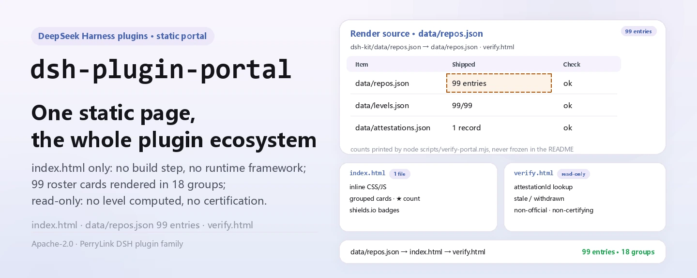
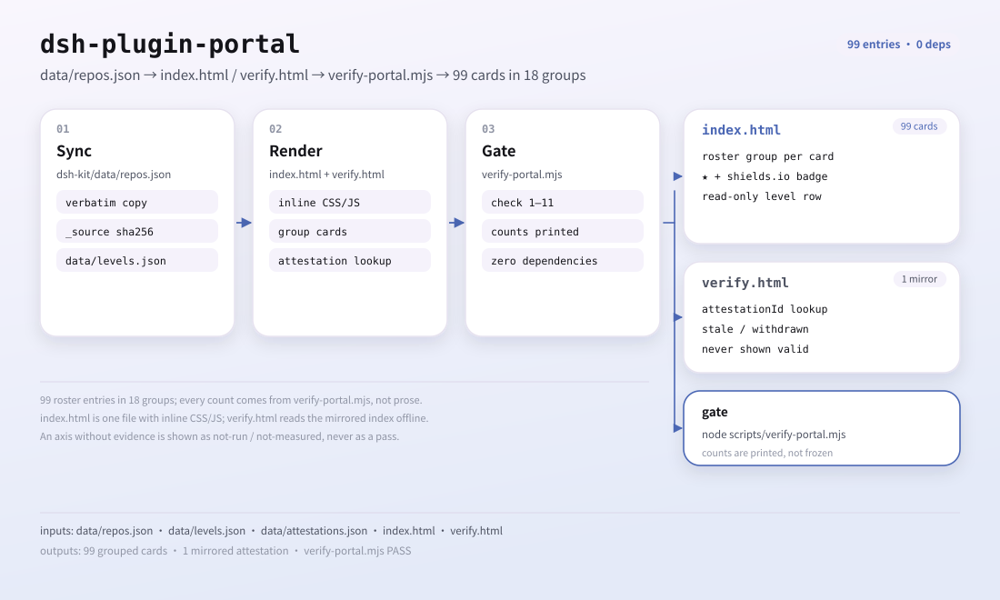

<div align="center">

<picture>
  <source media="(prefers-color-scheme: dark)" srcset="docs/assets/dsh-plugin-portal-hero-en-dark.webp">
  
</picture>

# dsh-plugin-portal

[English](README.md) · [简体中文](README-zh.md) · [Español](README-es.md) · [Português](README-pt.md) · [हिन्दी](README-hi.md)

</div>

**Portal de plugins PerryLink DSH** — un portal estático sin dependencias que renderiza el ecosistema de plugins de @perrylink DeepSeek Harness como tarjetas agrupadas: una sola página, sin paso de build y sin framework en runtime.

> Portal estático sin dependencias: una sola página, sin paso de build y sin framework en runtime, con el ecosistema de plugins de @perrylink DeepSeek Harness renderizado como tarjetas agrupadas.

---

<picture>
  <source media="(prefers-color-scheme: dark)" srcset="docs/assets/dsh-plugin-portal-flow-v5-dark.svg">
  
</picture>

*Estructura: data/repos.json → index.html / verify.html → compuerta. Las etiquetas del diagrama son rutas, nombres de archivo y el comando de la compuerta reales, por eso una sola imagen sirve para los cinco idiomas.*

## Panorama del ecosistema


*Animación: node scripts/verify-portal.mjs re-ejecutado el 2026-11-21 desde un checkout limpio — la comprobación 6 se omite porque falta el checkout hermano dsh-plugin-kit, exactamente como en un runner de CI. stdout real, sin llamadas de red.*

El portal renderiza el registro completo que sigue [`dsh-plugin-kit/data/repos.json`](https://github.com/PerryLink/dsh-plugin-kit/blob/main/data/repos.json): cada entrada del roster, los plugins más el repositorio de infraestructura `dsh-plugin-kit`. Cada tarjeta muestra el **nombre** del repo, una **descripción de una línea**, su **número de ★**, dos **badges de shields.io** (estrellas de GitHub en vivo + un badge de valoración estático) y el **enlace a GitHub**. Los recuentos autoritativos los imprime `node scripts/verify-portal.mjs` (el README evita deliberadamente congelar una cifra).
[](https://dshfind.com/plugins/PerryLink/dsh-plugin-portal?ref=badge)
[](https://www.npmjs.com/package/dsh-plugin-portal)
[](https://github.com/PerryLink/dsh-plugin-portal/actions/workflows/ci.yml)
[](LICENSE)

## Navegación por grupos

Las tarjetas se agrupan por el campo `group` del roster (clave del grupo → etiqueta en inglés):

| Grupo | Contenido |
|---|---|
| 基建 Infra | `dsh-scaffold` |
| 质量 Quality | `dsh-check-pack`, `dsh-doublecheck`, `dsh-data-quality`, `dsh-test-drive`, `dsh-score`, `dsh-fmea-table-check`, `dsh-ota-review-check`, `dsh-pipeline-check`, `dsh-ppap-check`, `dsh-repair-order-qc`, `dsh-review-reply-check`, `dsh-spc-gbt-adapter`, `dsh-warranty-calc` |
| 生态 Ecosystem | `dsh-community-bench`, `dsh-primer`, `dsh-cert-mcp`, `dsh-clinic`, `dsh-codemod` |
| 会话 Session | `dsh-memento`, `dsh-checkpoint-rewind`, `dsh-composer-history`, `dsh-background-agents`, `dsh-session-pin`, `dsh-session-sync`, `dsh-team-rooms` |
| 研究 Research | `dsh-phocinae`, `dsh-industry-research`, `dsh-fund-research`, `dsh-research-report`, `dsh-library`, `dsh-essay-rubric-check`, `dsh-learning-gap-check`, `dsh-nsfc-form-check`, `dsh-paper-doc-adapter`, `dsh-policy-brief-draft` |
| 集成 Integration | `dsh-phone-inbox`, `dsh-mcp-panel`, `dsh-claude-move`, `dsh-lsp-actions`, `dsh-local-ai`, `dsh-github-bot`, `dsh-autotier`, `dsh-laya`, `dsh-reach`, `dsh-dida` |
| 安全 Security | `dsh-auto-review`, `dsh-permission-rules`, `dsh-defend`, `dsh-mask`, `dsh-security-pack`, `dsh-aqua-input-check`, `dsh-drill-script-check`, `dsh-emergency-plan`, `dsh-hazchem-check`, `dsh-hidden-risk-map`, `dsh-power-loss-split`, `dsh-power-ticket-check` |
| 开发工具 Developer tools | `dsh-param-repair` |
| 桌面 Desktop | `dsh-click`, `dsh-talk`, `dsh-draw` |
| 观测 Observability | `dsh-budget`, `dsh-observe`, `dsh-fast` |
| UX | `dsh-output-styles` |
| 公文 Official Documents | `dsh-archive-check`, `dsh-gongwen-flow-check`, `dsh-gongwen-word-check` |
| 招投标 Tendering | `dsh-bid-ca-precheck`, `dsh-bid-qual-check`, `dsh-contract-stance`, `dsh-protest-deadline`, `dsh-rulefile-check`, `dsh-tender-extract`, `dsh-tender-matrix` |
| 外贸 Foreign Trade | `dsh-customs-doc-check`, `dsh-demurrage-ledger`, `dsh-export-ctl-check`, `dsh-forecast-penalty`, `dsh-hs-classify`, `dsh-lc-doc-check`, `dsh-origin-rvc-check`, `dsh-railway-window` |
| 工程建设 Construction | `dsh-eia-guide-check`, `dsh-guard-plan-qc`, `dsh-hazplan-check`, `dsh-permit-report-check`, `dsh-safety-brief-check`, `dsh-site-log-check`, `dsh-soilwater-check` |
| 法律 Legal | `dsh-evidence-check`, `dsh-lawcite-adapter`, `dsh-pleading-draft` |
| 医疗 Medical | `dsh-icd-rule-check`, `dsh-medrec-qc`, `dsh-nurse-record-check` |
| 治理 Governance | `dsh-soe-decision-check`, `dsh-sop-sync-check` |

Los recuentos por grupo los imprime la compuerta (`node scripts/verify-portal.mjs`) en lugar de congelarse aquí.

## Estado P0

Los P0 — lo imprescindible del portal — están **hechos** para la v1:

- **Portal estático v1** ✅ — `index.html` es un solo archivo con CSS/JS en línea; cero dependencias externas de runtime.
- **Sincronización de la fuente de datos** ✅ — `data/repos.json` es una copia literal de `dsh-plugin-kit/data/repos.json` (más una nota de sincronización `_source`).
- **Render agrupado** ✅ — una tarjeta por entrada del roster, agrupadas por `group`.
- **Badges de calidad** ✅ — `img.shields.io/github/stars/…` en vivo + un badge de valoración estático por tarjeta; sin autohosting.

P1/P2 (ya incluidos en esta revisión): chips de nivel de adopción de solo lectura, el índice de atestaciones espejado y la consulta en `verify.html`. Siguen fuera de alcance: el pipeline de actualización automática de estrellas y valoración, la búsqueda y el filtro, las páginas de detalle por plugin y un servicio de badges autohospedado.

## Señales de calidad

Cada tarjeta muestra dos señales de calidad: el **número de ★** del roster (instantánea sincronizada) y un **badge de estrellas en vivo** de GitHub vía shields.io. El badge de valoración estático refleja el valor `star` sincronizado (`n/a` para `dsh-plugin-kit`, que no publica número de estrellas). Estas señales son solo de visualización — el portal no puntúa nada por su cuenta; la puntuación vive en `dsh-plugin-kit`.

## Visualización de solo lectura

El portal **solo muestra** niveles de adopción y atestaciones: **no calcula un nivel**, **no emite, valida ni revoca una atestación** y **no es un sitio oficial, ni un organismo de certificación, ni una auditoría de seguridad**, ni representa a DeepSeek. Un eje sin registro de evidencia se muestra como `not-run` / `not-measured`, nunca como aprobado; las tarjetas mantienen el orden del roster y nunca se ordenan ni ponderan por nivel.

- `data/levels.json` — una proyección de solo lectura de las tres profundidades de adopción (`entry` / `flow` / `boost`) para cada repo del roster. Un eje sin registro de evidencia se muestra como `not-run` / `not-measured`, nunca como aprobado; las tarjetas mantienen el orden del roster y nunca se ordenan ni ponderan por nivel.
- `data/attestations.json` — un espejo del `publish/attestations/index.json` del repositorio estándar. `source` apunta a la ruta o URL upstream y `records` copia los archivos de atestación referenciados por `file`, así que la página de verificación no necesita ninguna llamada de red. Los grados de atestación A–D son ortogonales a los niveles y nunca se convierten.
- `verify.html` — busca un `attestationId` y lee su subject, grado, claimLevel, estado, fechas, alcance, lista de exclusiones, exención de responsabilidad y enlaces de evidencia. Un registro caducado se muestra como `stale` y uno retirado como `withdrawn`; ninguno se muestra nunca como válido. La página lleva la misma advertencia que la vista principal: 非官方 · 非认证 · 非安全审计.

## Estructura y sincronización

```
dsh-plugin-portal/
├── index.html              # 单文件门户（内联 CSS/JS，无外部运行时依赖）
├── verify.html             # attestationId 只读查验（零依赖、静态、无构建）
├── data/repos.json         # 从 dsh-plugin-kit/data/repos.json 复制的清单（见 _source 注释）
├── data/levels.json        # 三层采用深度的只读投影（不计算 level）
├── data/attestations.json  # 标准仓 publish/attestations/index.json 的镜像
├── scripts/verify-portal.mjs # 零依赖门禁（roster + levels + attestations + pages）
├── package.json            # npm test 别名；无依赖、无安装步骤
└── README.md               # 本文件
```

`data/repos.json` **no** es la fuente de la verdad: [`dsh-plugin-kit/data/repos.json`](https://github.com/PerryLink/dsh-plugin-kit/blob/main/data/repos.json) es el dueño del roster y de los recuentos de estrellas. Para refrescar este portal, vuelve a copiar ese archivo sobre `data/repos.json`.

## Vista previa local

Ábrelo por HTTP (las páginas hacen fetch de `data/repos.json`, `data/levels.json` y `data/attestations.json`, que `file://` bloquea):

```sh
python -m http.server 8080
# then open http://localhost:8080/ and http://localhost:8080/verify.html
```

## Validación

No hace falta navegador ni paso de instalación: la compuerta es sin dependencias y lo afirma sobre sí misma, así que el portal sigue siendo ejecutable desde un checkout limpio.

```sh
node scripts/verify-portal.mjs   # the gate itself
npm test                         # same gate, no install step (package.json has no dependencies)
```

Imprime los recuentos autoritativos (entradas, grupos, por grupo) y comprueba:

1. que la compuerta no importa nada más que los builtins de `node:`;
2. que `data/repos.json` cumple el contrato del roster — `name`/`group`/`role`/`star`, una URL `https://github.com/<owner>/<repo>` cuyo segmento de repo coincide con `name`, y ningún nombre duplicado;
3. que el script en línea de `index.html` parsea (`new vm.Script`) y se ejecuta bajo un stub de DOM;
4. que cada entrada del roster tiene un blurb en `DESCRIPTIONS` y cada grupo una etiqueta `GROUP_EN` — una entrada cuyo blurb aún no haya llegado debe estar registrada en `PENDING_DESCRIPTION` (la allowlist deliberada), o la compuerta falla;
5. que los badges de estrellas derivan su owner de `repo.github`, incluidos los owners de terceros (`pan17/dsh-wechat`) — sin ningún owner codificado a mano;
6. que `data/repos.json` es una **copia literal** del `dsh-plugin-kit/data/repos.json` upstream salvo `_source`, y que el sha256 registrado en `_source` sigue coincidiendo con ese archivo. En un runner sin el checkout hermano del kit (CI) esta comprobación informa `skip` en lugar de fallar, así que la compuerta nunca se pone en rojo por un motivo que el runner no pueda arreglar;
7. que el README no congela un recuento;
8. que `data/levels.json` solo referencia repos del roster, cubre todos ellos, usa el enum de estado por nivel, y cada estado `runtime` / `measured` / `manual` lleva un `evidence.url` `https` — `not-run` nunca se asciende a aprobado;
9. que `data/attestations.json` replica el índice del repositorio estándar con `attestationId`s únicos, fechas `expiresAt` reales, detalle para cada registro y **ningún campo `level` en ninguna parte** (un grado es ortogonal a un nivel de adopción);
10. que `verify.html` parsea, muestra 非官方 · 非认证 · 非安全审计 en la misma vista, y clasifica un registro caducado o retirado como `stale` / `withdrawn` — nunca `valid`;
11. que `index.html` renderiza la fila opcional de nivel desde `data/levels.json`, muestra `not-run` / `not-measured` en lugar de un badge vacío y enlaza la evidencia cuando un registro la tiene.

Dos comportamientos que conviene conocer al leer una tarjeta: el owner del badge de estrellas procede de la propia URL `github` de la entrada del roster, y una entrada del roster sin blurb renderiza el marcador visible **`description not synced`** (acento, cursiva) más un `console.warn` en lugar de mostrar silenciosamente texto de relleno.

## Familia de plugins PerryLink DSH

Este proyecto forma parte de la familia de plugins de DeepSeek Harness de [PerryLink](https://github.com/PerryLink). El índice completo grupo por grupo — estándares y comprobaciones, guías, cadena de herramientas de desarrollo, plugins de runtime, la suite de cumplimiento de 53 comprobadores, operaciones de dominio, catálogos y la línea de decisión Phocinae, que va por separado — está en [FAMILY.md](https://github.com/PerryLink/PerryLink/blob/main/FAMILY.md). El roster se deja plegado aquí abajo para que todos los README mantengan una primera pantalla corta; despliégalo para ver cada fila y su estado.

<details>
<summary>Expandir todos los plugins</summary>

| Plugin | Estado |
|---|---|
| **[dsh-aqua-input-check](https://github.com/PerryLink/dsh-aqua-input-check)** |  |
| **[dsh-archive-check](https://github.com/PerryLink/dsh-archive-check)** |  |
| **[dsh-auto-review](https://github.com/PerryLink/dsh-auto-review)** |  |
| **[dsh-bid-ca-precheck](https://github.com/PerryLink/dsh-bid-ca-precheck)** |  |
| **[dsh-bid-qual-check](https://github.com/PerryLink/dsh-bid-qual-check)** |  |
| **[dsh-check-pack](https://github.com/PerryLink/dsh-check-pack)** |  |
| **[dsh-checkpoint-rewind](https://github.com/PerryLink/dsh-checkpoint-rewind)** |  |
| **[dsh-click](https://github.com/PerryLink/dsh-click)** |  |
| **[dsh-clinic](https://github.com/PerryLink/dsh-clinic)** |  |
| **[dsh-codemod](https://github.com/PerryLink/dsh-codemod)** |  |
| **[dsh-composer-history](https://github.com/PerryLink/dsh-composer-history)** |  |
| **[dsh-contract-stance](https://github.com/PerryLink/dsh-contract-stance)** |  |
| **[dsh-customs-doc-check](https://github.com/PerryLink/dsh-customs-doc-check)** |  |
| **[dsh-data-quality](https://github.com/PerryLink/dsh-data-quality)** |  |
| **[dsh-demurrage-ledger](https://github.com/PerryLink/dsh-demurrage-ledger)** |  |
| **[dsh-dida](https://github.com/PerryLink/dsh-dida)** |  |
| **[dsh-doublecheck](https://github.com/PerryLink/dsh-doublecheck)** |  |
| **[dsh-drill-script-check](https://github.com/PerryLink/dsh-drill-script-check)** |  |
| **[dsh-eia-guide-check](https://github.com/PerryLink/dsh-eia-guide-check)** |  |
| **[dsh-emergency-plan](https://github.com/PerryLink/dsh-emergency-plan)** |  |
| **[dsh-essay-rubric-check](https://github.com/PerryLink/dsh-essay-rubric-check)** |  |
| **[dsh-evidence-check](https://github.com/PerryLink/dsh-evidence-check)** |  |
| **[dsh-export-ctl-check](https://github.com/PerryLink/dsh-export-ctl-check)** |  |
| **[dsh-fast](https://github.com/PerryLink/dsh-fast)** |  |
| **[dsh-fmea-table-check](https://github.com/PerryLink/dsh-fmea-table-check)** |  |
| **[dsh-forecast-penalty](https://github.com/PerryLink/dsh-forecast-penalty)** |  |
| **[dsh-fund-research](https://github.com/PerryLink/dsh-fund-research)** |  |
| **[dsh-github-bot](https://github.com/PerryLink/dsh-github-bot)** |  |
| **[dsh-gongwen-flow-check](https://github.com/PerryLink/dsh-gongwen-flow-check)** |  |
| **[dsh-gongwen-word-check](https://github.com/PerryLink/dsh-gongwen-word-check)** |  |
| **[dsh-guard-plan-qc](https://github.com/PerryLink/dsh-guard-plan-qc)** |  |
| **[dsh-hazchem-check](https://github.com/PerryLink/dsh-hazchem-check)** |  |
| **[dsh-hazplan-check](https://github.com/PerryLink/dsh-hazplan-check)** |  |
| **[dsh-hidden-risk-map](https://github.com/PerryLink/dsh-hidden-risk-map)** |  |
| **[dsh-hs-classify](https://github.com/PerryLink/dsh-hs-classify)** |  |
| **[dsh-icd-rule-check](https://github.com/PerryLink/dsh-icd-rule-check)** |  |
| **[dsh-industry-research](https://github.com/PerryLink/dsh-industry-research)** |  |
| **[dsh-lawcite-adapter](https://github.com/PerryLink/dsh-lawcite-adapter)** |  |
| **[dsh-laya](https://github.com/PerryLink/dsh-laya)** |  |
| **[dsh-lc-doc-check](https://github.com/PerryLink/dsh-lc-doc-check)** |  |
| **[dsh-learning-gap-check](https://github.com/PerryLink/dsh-learning-gap-check)** |  |
| **[dsh-library](https://github.com/PerryLink/dsh-library)** |  |
| **[dsh-local-ai](https://github.com/PerryLink/dsh-local-ai)** |  |
| **[dsh-lsp-actions](https://github.com/PerryLink/dsh-lsp-actions)** |  |
| **[dsh-mask](https://github.com/PerryLink/dsh-mask)** |  |
| **[dsh-mcp-panel](https://github.com/PerryLink/dsh-mcp-panel)** |  |
| **[dsh-medrec-qc](https://github.com/PerryLink/dsh-medrec-qc)** |  |
| **[dsh-memento](https://github.com/PerryLink/dsh-memento)** |  |
| **[dsh-nsfc-form-check](https://github.com/PerryLink/dsh-nsfc-form-check)** |  |
| **[dsh-nurse-record-check](https://github.com/PerryLink/dsh-nurse-record-check)** |  |
| **[dsh-observe](https://github.com/PerryLink/dsh-observe)** |  |
| **[dsh-origin-rvc-check](https://github.com/PerryLink/dsh-origin-rvc-check)** |  |
| **[dsh-ota-review-check](https://github.com/PerryLink/dsh-ota-review-check)** |  |
| **[dsh-output-styles](https://github.com/PerryLink/dsh-output-styles)** |  |
| **[dsh-paper-doc-adapter](https://github.com/PerryLink/dsh-paper-doc-adapter)** |  |
| **[dsh-param-repair](https://github.com/PerryLink/dsh-param-repair)** |  |
| **[dsh-permission-rules](https://github.com/PerryLink/dsh-permission-rules)** |  |
| **[dsh-permit-report-check](https://github.com/PerryLink/dsh-permit-report-check)** |  |
| **[dsh-phocinae](https://github.com/PerryLink/dsh-phocinae)** |  |
| **[dsh-phone-inbox](https://github.com/PerryLink/dsh-phone-inbox)** |  |
| **[dsh-pipeline-check](https://github.com/PerryLink/dsh-pipeline-check)** |  |
| **[dsh-pleading-draft](https://github.com/PerryLink/dsh-pleading-draft)** |  |
| **[dsh-policy-brief-draft](https://github.com/PerryLink/dsh-policy-brief-draft)** |  |
| **[dsh-power-loss-split](https://github.com/PerryLink/dsh-power-loss-split)** |  |
| **[dsh-power-ticket-check](https://github.com/PerryLink/dsh-power-ticket-check)** |  |
| **[dsh-ppap-check](https://github.com/PerryLink/dsh-ppap-check)** |  |
| **[dsh-primer](https://github.com/PerryLink/dsh-primer)** |  |
| **[dsh-protest-deadline](https://github.com/PerryLink/dsh-protest-deadline)** |  |
| **[dsh-railway-window](https://github.com/PerryLink/dsh-railway-window)** |  |
| **[dsh-repair-order-qc](https://github.com/PerryLink/dsh-repair-order-qc)** |  |
| **[dsh-research-report](https://github.com/PerryLink/dsh-research-report)** |  |
| **[dsh-review-reply-check](https://github.com/PerryLink/dsh-review-reply-check)** |  |
| **[dsh-rulefile-check](https://github.com/PerryLink/dsh-rulefile-check)** |  |
| **[dsh-safety-brief-check](https://github.com/PerryLink/dsh-safety-brief-check)** |  |
| **[dsh-scaffold](https://github.com/PerryLink/dsh-scaffold)** |  |
| **[dsh-score](https://github.com/PerryLink/dsh-score)** |  |
| **[dsh-security-pack](https://github.com/PerryLink/dsh-security-pack)** |  |
| **[dsh-session-sync](https://github.com/PerryLink/dsh-session-sync)** |  |
| **[dsh-site-log-check](https://github.com/PerryLink/dsh-site-log-check)** |  |
| **[dsh-soe-decision-check](https://github.com/PerryLink/dsh-soe-decision-check)** |  |
| **[dsh-soilwater-check](https://github.com/PerryLink/dsh-soilwater-check)** |  |
| **[dsh-sop-sync-check](https://github.com/PerryLink/dsh-sop-sync-check)** |  |
| **[dsh-spc-gbt-adapter](https://github.com/PerryLink/dsh-spc-gbt-adapter)** |  |
| **[dsh-talk](https://github.com/PerryLink/dsh-talk)** |  |
| **[dsh-tender-extract](https://github.com/PerryLink/dsh-tender-extract)** |  |
| **[dsh-tender-matrix](https://github.com/PerryLink/dsh-tender-matrix)** |  |
| **[dsh-test-drive](https://github.com/PerryLink/dsh-test-drive)** |  |
| **[dsh-warranty-calc](https://github.com/PerryLink/dsh-warranty-calc)** |  |
| **[dsh-autotier](https://github.com/PerryLink/dsh-autotier)** | 🧊 CONGELADO — ver el README del repositorio |
| **[dsh-budget](https://github.com/PerryLink/dsh-budget)** | 🧊 CONGELADO — ver el README del repositorio |
| **[dsh-cert-mcp](https://github.com/PerryLink/dsh-cert-mcp)** | 🧊 CONGELADO — ver el README del repositorio |
| **[dsh-claude-move](https://github.com/PerryLink/dsh-claude-move)** | 🧊 CONGELADO — ver el README del repositorio |
| **[dsh-community-bench](https://github.com/PerryLink/dsh-community-bench)** | 🧊 CONGELADO — ver el README del repositorio |
| **[dsh-defend](https://github.com/PerryLink/dsh-defend)** | 🧊 CONGELADO — ver el README del repositorio |
| **[dsh-draw](https://github.com/PerryLink/dsh-draw)** | 🧊 CONGELADO — ver el README del repositorio |
| **[dsh-reach](https://github.com/PerryLink/dsh-reach)** | 🧊 CONGELADO — ver el README del repositorio |
| **[dsh-background-agents](https://github.com/PerryLink/dsh-background-agents)** | 🚫 RETIRADO — ver el README del repositorio |
| **[dsh-session-pin](https://github.com/PerryLink/dsh-session-pin)** | 🚫 RETIRADO — ver el README del repositorio |
| **[dsh-team-rooms](https://github.com/PerryLink/dsh-team-rooms)** | 🚫 RETIRADO — ver el README del repositorio |

</details>

## Niveles de adopción (no oficiales)

El ecosistema avanza hacia tres **profundidades de adopción**, no notas: **DSH-ENTRY** (límite de compatibilidad — ¿se puede instalar y arrancar?), **DSH-FLOW** (usabilidad recomendada — ¿puede un usuario instalarlo, configurarlo, recuperarlo, actualizarlo y desinstalarlo?) y **DSH-BOOST** (práctica Cordis — ¿es mediblemente más barato?). No son una certificación, ni un ranking, ni cuentan con el respaldo de DeepSeek.

- Copia pública de enseñanza: [dsh-plugin-guide/guide/standards.md](https://github.com/PerryLink/dsh-plugin-guide/blob/main/guide/standards.md)
- `dsh-plugin-doctor` expone una proyección ENTRY en su informe JSON; `dsh-plugin-certification` explica por qué sus grados A–D son ortogonales a los niveles.
- El `spec/levels.json` legible por máquina y la herramienta de auditoría viven en el proyecto privado `dsh-standards` (borrador; pregunta al mantenedor). Este portal no envía ni reimplementa esa spec: solo renderiza las etiquetas espejadas en `data/levels.json`, y `verify.html` lee el índice de atestaciones espejado. El portal es de solo lectura: no calcula el level ni certifica nada.
