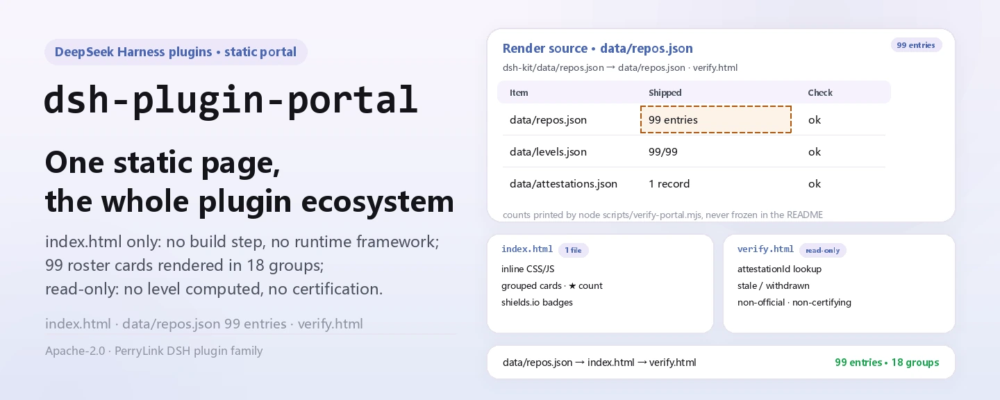
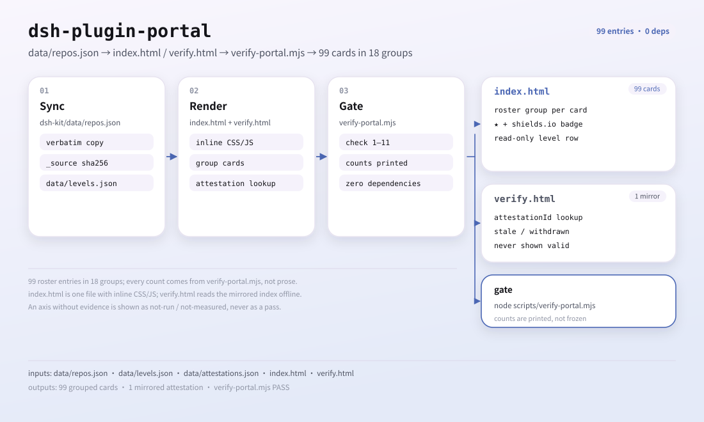
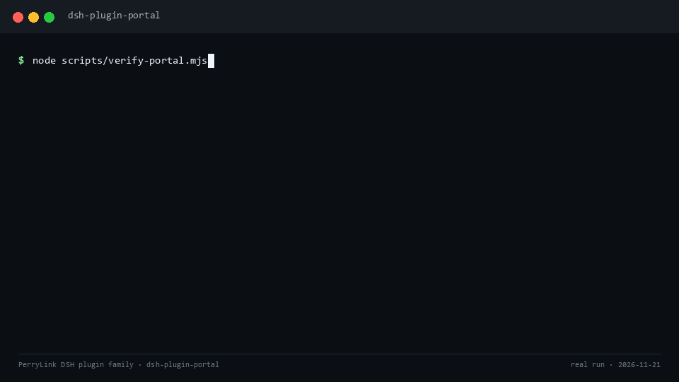

<picture>
  <source media="(prefers-color-scheme: dark)" srcset="docs/assets/dsh-plugin-portal-hero-en-dark.webp">
  
</picture>

# dsh-plugin-portal

PerryLink DSH प्लगइन पारिस्थितिकी के लिए बिना निर्भरता वाला स्थिर पोर्टल: पूरे roster पर एक समूहित-कार्ड पृष्ठ और एक केवल-पढ़न सत्यापन पृष्ठ।

[English](README.md) · [简体中文](README-zh.md) · [Español](README-es.md) · [Português](README-pt.md) · [हिन्दी](README-hi.md)

> यह फ़ाइल हिन्दी स्थानीयकृत प्रवेश है; पूरा तकनीकी विवरण अंग्रेज़ी [README.md](README.md) में है और यहाँ दोहराया नहीं गया है।

<picture>
  <source media="(prefers-color-scheme: dark)" srcset="docs/assets/dsh-plugin-portal-flow-v5-dark.svg">
  
</picture>

*संरचना: data/repos.json → index.html / verify.html → गेट। चित्र के लेबल असली पथ, फ़ाइल नाम और गेट कमांड हैं, इसलिए एक ही चित्र पाँचों भाषाओं के लिए है।*

## पारिस्थितिकी अवलोकन / Ecosystem overview

*एनिमेशन: 2026-11-21 को साफ़ checkout से node scripts/verify-portal.mjs का दोबारा रन — sibling dsh-plugin-kit न होने से check 6 skip होता है, ठीक CI runner की तरह। असली stdout, कोई नेटवर्क कॉल नहीं।*

पोर्टल `dsh-plugin-kit/data/repos.json` का पूरा roster रेंडर करता है (सभी प्लगइन रिपॉज़िटरी + `dsh-plugin-kit` इंफ्रा रिपॉज़िटरी): हर कार्ड में नाम, एक पंक्ति का विवरण, ★ संख्या, दो shields.io बैज और GitHub लिंक दिखते हैं; प्रामाणिक गिनतियाँ `node scripts/verify-portal.mjs` छापता है और README उन्हें स्थिर नहीं करता। पूरा विवरण अंग्रेज़ी [README.md](README.md) में है।

## समूह नेविगेशन / Grouped navigation

कार्ड roster के `group` फ़ील्ड से समूहित होते हैं, हर समूह के द्विभाषी लेबल और सामग्री सूची के साथ; प्रति-समूह गिनतियाँ भी `node scripts/verify-portal.mjs` छापता है, दस्तावेज़ में स्थिर नहीं होतीं। पूरी तालिका अंग्रेज़ी README में है।

## P0 स्थिति / P0 status

P0 (पोर्टल की बुनियादी अनिवार्यताएँ) v1 में पूरी हैं: एक-फ़ाइल स्थिर पोर्टल, डेटा स्रोत सिंक, समूहित रेंडर और गुणवत्ता बैज; P1/P2 के केवल-पढ़न adoption-level chips, प्रमाणन मिरर और `verify.html` जाँच लागू हैं; स्वतः रिफ़्रेश, खोज/फ़िल्टर, विवरण पृष्ठ और स्वयं-होस्टेड बैज सेवा अभी दायरे से बाहर हैं।

## गुणवत्ता संकेत / Quality signals

हर कार्ड दो संकेत दिखाता है: roster स्नैपशॉट से ★ संख्या और shields.io से लाइव स्टार बैज; स्थिर रेटिंग बैज सिंक किए गए `star` मान को दिखाता है (`dsh-plugin-kit` के लिए `n/a`, जिसके पास स्टार संख्या नहीं है)। ये केवल प्रदर्शन संकेत हैं; स्कोरिंग `dsh-plugin-kit` में है।

## केवल-पढ़न प्रदर्शन / Read-only display

पोर्टल केवल adoption levels और प्रमाणन दिखाता है: level की गणना नहीं करता, प्रमाणन जारी/सत्यापित/रद्द नहीं करता, और न आधिकारिक साइट है, न प्रमाणन निकाय, न सुरक्षा ऑडिट; बिना साक्ष्य वाला अक्ष `not-run` / `not-measured` दिखता है, कभी पास के रूप में नहीं। `verify.html` में समाप्त रिकॉर्ड `stale` और वापस लिया गया `withdrawn` दिखता है, कभी वैध नहीं।

## संरचना और सिंक / Layout & sync

`index.html` और `verify.html` बिना निर्भरता वाले पृष्ठ हैं; `data/repos.json` `dsh-plugin-kit/data/repos.json` roster की प्रतिलिपि है (`_source` में upstream sha256 दर्ज), `data/levels.json` तीन adoption गहराइयों का केवल-पढ़न प्रक्षेपण है और `data/attestations.json` प्रमाणन सूचकांक का मिरर; रिफ़्रेश के लिए upstream फ़ाइल फिर कॉपी करें। पूरा वृक्ष अंग्रेज़ी README में है।

## स्थानीय पूर्वावलोकन / Local preview

HTTP से खोलें (पृष्ठ तीनों `data/*.json` fetch करते हैं, `file://` उन्हें रोकता है): `python -m http.server 8080`, फिर `http://localhost:8080/` और `http://localhost:8080/verify.html` खोलें।

## सत्यापन / Validation

बिना निर्भरता वाला गेट: `node scripts/verify-portal.mjs` (या बिना इंस्टॉल `npm test`) प्रामाणिक गिनतियाँ छापता है और 11 जाँचें चलाता है — शून्य निर्भरता, roster अनुबंध, इनलाइन स्क्रिप्ट, blurb कवरेज, owner व्युत्पत्ति, upstream से ज्यों का त्यों प्रतिलिपि, README में स्थिर गिनती नहीं, levels साक्ष्य, प्रमाणन मिरर, verify पृष्ठ और level पंक्ति; असली रन ऊपर के एनिमेशन में है।

## PerryLink DSH प्लगइन परिवार

यह रिपॉज़िटरी [PerryLink](https://github.com/PerryLink) के DeepSeek Harness प्लगइन परिवार का हिस्सा है; पूरा समूह-सूचकांक [FAMILY.md](https://github.com/PerryLink/PerryLink/blob/main/FAMILY.md) में और पूरा roster अंग्रेज़ी [README.md](README.md) में है।

## अपनाने के स्तर (गैर-आधिकारिक)

पारिस्थितिकी तीन adoption गहराइयों की ओर बढ़ रही है: `DSH-ENTRY` (इंस्टॉल और बूट हो सके), `DSH-FLOW` (कॉन्फ़िगर, रिकवर, अपग्रेड और अनइंस्टॉल हो सके) और `DSH-BOOST` (Cordis अभ्यास और मापा जा सकने वाला खर्च); ये प्रमाणन, रैंकिंग या DeepSeek का समर्थन नहीं हैं। मशीन-पठनीय spec निजी `dsh-standards` परियोजना में है; यह पोर्टल केवल `data/levels.json` मिरर रेंडर करता है।

[Privacy](PRIVACY.md) · [Security](SECURITY.md) · [Contributing](CONTRIBUTING.md) · [Changelog](CHANGELOG.md)
