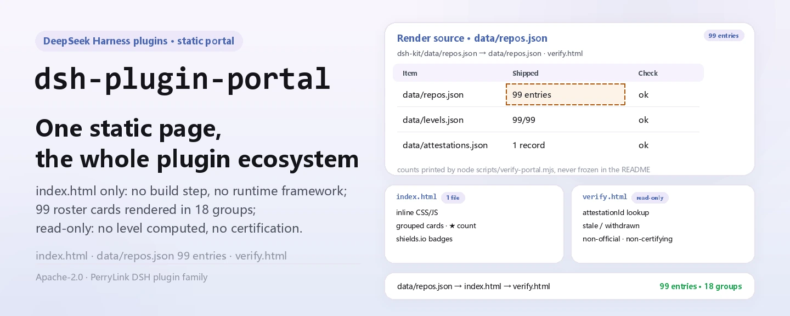
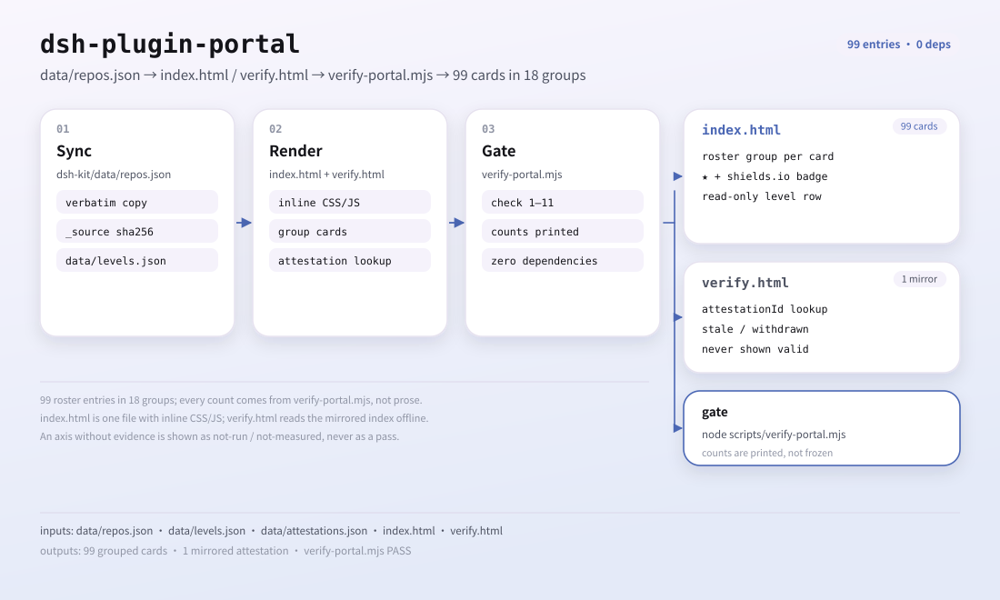
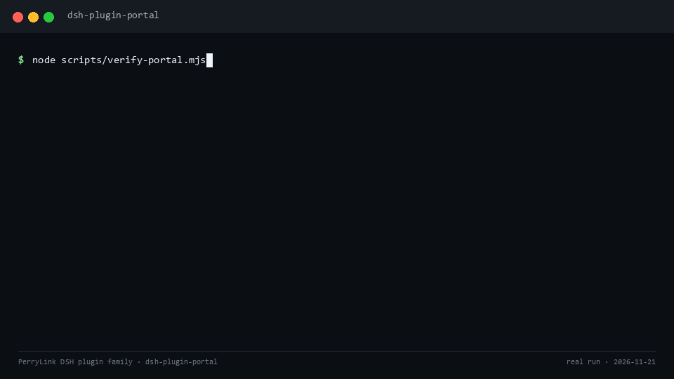

<picture>
  <source media="(prefers-color-scheme: dark)" srcset="docs/assets/dsh-plugin-portal-hero-en-dark.webp">
  
</picture>

# dsh-plugin-portal

Portal estático sem dependências para o ecossistema de plugins PerryLink DSH: uma página de cartões agrupados sobre o roster completo, mais uma página de consulta de atestações somente leitura.

[English](README.md) · [简体中文](README-zh.md) · [Español](README-es.md) · [Português](README-pt.md) · [हिन्दी](README-hi.md)

> Este arquivo é a entrada localizada em português; o corpo técnico completo está no [README.md](README.md) em inglês e não é repetido aqui.

<picture>
  <source media="(prefers-color-scheme: dark)" srcset="docs/assets/dsh-plugin-portal-flow-v5-dark.svg">
  
</picture>

*Estrutura: data/repos.json → index.html / verify.html → portão. Os rótulos do diagrama são caminhos, nomes de arquivo e o comando do portão reais, então uma única imagem serve aos cinco idiomas.*

## Visão geral do ecossistema / Ecosystem overview

*Animação: node scripts/verify-portal.mjs reexecutado em 2026-11-21 a partir de um checkout limpo — a verificação 6 é omitida porque o checkout irmão dsh-plugin-kit está ausente, exatamente como em um runner de CI. stdout real, sem chamadas de rede.*

O portal renderiza o roster completo de `dsh-plugin-kit/data/repos.json` (todos os repositórios de plugins + o repositório de infraestrutura `dsh-plugin-kit`): cada cartão mostra nome, descrição de uma linha, número de ★, dois badges do shields.io e o link para o GitHub; as contagens autoritativas são impressas por `node scripts/verify-portal.mjs` e o README evita congelá-las. O detalhe completo está no [README.md](README.md) em inglês.

## Navegação por grupos / Grouped navigation

Os cartões são agrupados pelo campo `group` do roster, com rótulo bilíngue e lista de conteúdo por grupo; as contagens por grupo também são impressas por `node scripts/verify-portal.mjs`, não congeladas na documentação. A tabela completa está no README em inglês.

## Status P0 / P0 status

O P0 (o essencial do portal) está concluído na v1: portal estático de arquivo único, sincronização da fonte de dados, render agrupado e badges de qualidade; P1/P2 já incluem chips de nível de adoção somente leitura, o espelho de atestações e a consulta em `verify.html`; seguem fora de escopo a atualização automática, a busca/filtro, as páginas de detalhe e o serviço de badges próprio.

## Sinais de qualidade / Quality signals

Cada cartão mostra dois sinais: o número de ★ do snapshot do roster e um badge de estrelas ao vivo do shields.io; o badge estático reflete o valor `star` sincronizado (`n/a` para `dsh-plugin-kit`, que não publica estrelas). São apenas sinais de exibição: a pontuação vive em `dsh-plugin-kit`.

## Exibição somente leitura / Read-only display

O portal apenas exibe níveis de adoção e atestações: não calcula nível, não emite, valida nem revoga atestações, e não é site oficial, órgão de certificação ou auditoria de segurança; um eixo sem evidência aparece `not-run` / `not-measured`, nunca como aprovado. No `verify.html`, registro vencido aparece `stale` e retirado `withdrawn`, nunca válido.

## Estrutura e sincronização / Layout & sync

`index.html` e `verify.html` são páginas sem dependências; `data/repos.json` é uma cópia do roster de `dsh-plugin-kit/data/repos.json` (o `_source` registra o sha256 de origem), `data/levels.json` é uma projeção somente leitura das três profundidades de adoção e `data/attestations.json` é um espelho do índice de atestações; para atualizar, copie o arquivo de origem de novo. A árvore completa está no README em inglês.

## Prévia local / Local preview

Abra por HTTP (as páginas buscam os três `data/*.json`, que o `file://` bloqueia): `python -m http.server 8080` e depois acesse `http://localhost:8080/` e `http://localhost:8080/verify.html`.

## Validação / Validation

Portão sem dependências: `node scripts/verify-portal.mjs` (ou `npm test`, sem instalar) imprime as contagens autoritativas e executa 11 verificações — zero dependências, contrato do roster, script inline, cobertura de blurbs, derivação do owner, cópia literal do upstream, README sem contagens congeladas, evidência dos levels, espelho de atestações, página verify e linha de nível; a execução real está na animação acima.

## Família de plugins PerryLink DSH

Este repositório faz parte da família de plugins do DeepSeek Harness da [PerryLink](https://github.com/PerryLink); o índice completo por grupos está em [FAMILY.md](https://github.com/PerryLink/PerryLink/blob/main/FAMILY.md) e o roster completo no [README.md](README.md) em inglês.

## Níveis de adoção (não oficiais)

O ecossistema caminha para três profundidades de adoção: `DSH-ENTRY` (instalável e inicializável), `DSH-FLOW` (configurável, recuperável, atualizável e desinstalável) e `DSH-BOOST` (prática Cordis e custo mensurável); não são certificação, ranking nem endosso do DeepSeek. A spec legível por máquina está no projeto privado `dsh-standards`; este portal apenas renderiza o espelho `data/levels.json`.

[Privacy](PRIVACY.md) · [Security](SECURITY.md) · [Contributing](CONTRIBUTING.md) · [Changelog](CHANGELOG.md)
