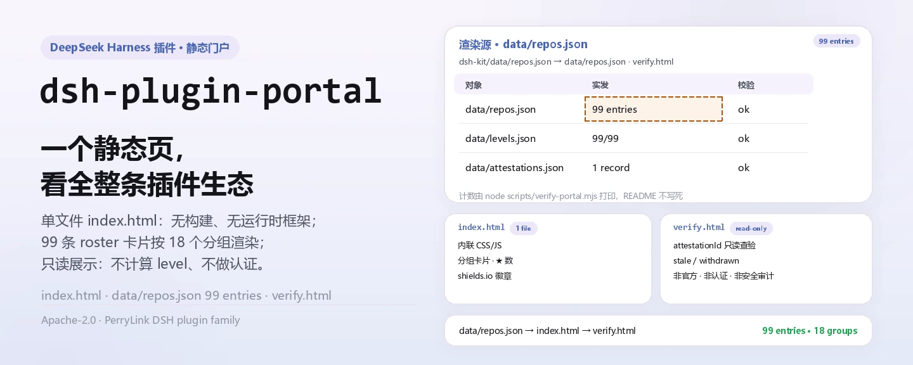
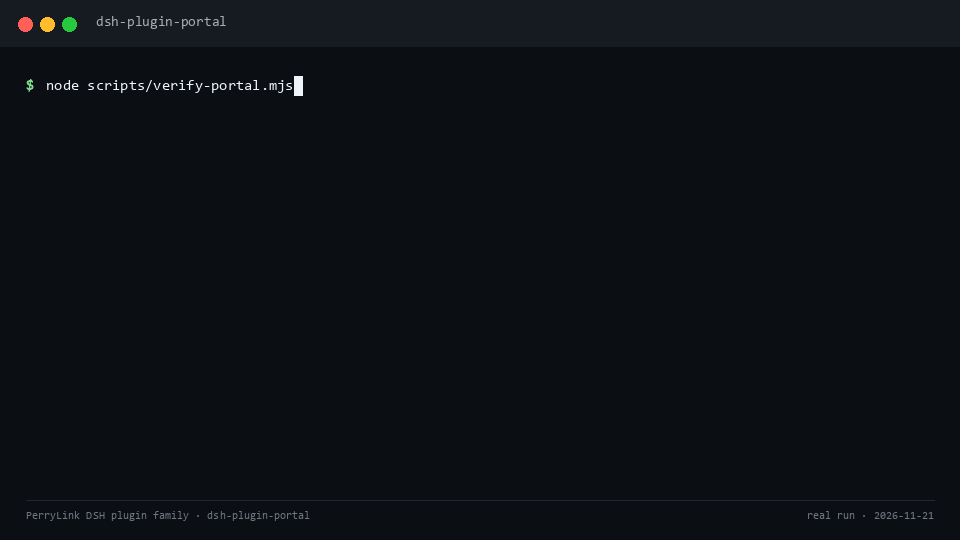

<picture>
  <source media="(prefers-color-scheme: dark)" srcset="docs/assets/dsh-plugin-portal-hero-zh-dark.webp">
  
</picture>

# dsh-plugin-portal

PerryLink DSH 插件生态的零依赖静态门户：单页分组卡片渲染完整 roster，并带一个只读的认证查验页。

[English](README.md) · [简体中文](README-zh.md) · [Español](README-es.md) · [Português](README-pt.md) · [हिन्दी](README-hi.md)

> 本文件是简体中文本地化入口；完整技术文档以英文 [README.md](README.md) 为准，正文不在此重复翻译。

<picture>
  <source media="(prefers-color-scheme: dark)" srcset="docs/assets/dsh-plugin-portal-flow-v5-dark.svg">
  
</picture>

*结构：data/repos.json → index.html / verify.html → 门禁。图内是真实路径、文件名与门禁命令，五语共用一张图。*

## 生态总览 / Ecosystem overview

*动图是本仓库门禁于 2026-11-21 的复跑：从纯净检出执行 node scripts/verify-portal.mjs，因无同级 dsh-plugin-kit 而 check 6 为 skip（与 CI runner 相同）。真实 stdout，不联网。*

门户渲染 `dsh-plugin-kit/data/repos.json` 记录的完整清单（全部插件仓 + `dsh-plugin-kit` 基建仓）：每张卡片展示名称、一句话简介、★ 数、两个 shields.io 徽章与 GitHub 链接；权威计数由 `node scripts/verify-portal.mjs` 打印，README 刻意不写死数字。完整说明见英文 [README.md](README.md)。

## 分组导航 / Grouped navigation

卡片按 roster 的 `group` 字段分组，每组有中英标签与内容清单；每组数量同样由 `node scripts/verify-portal.mjs` 打印，而不是冻结在文档里。完整分组表见英文 README。

## P0 状态 / P0 status

P0（门户基础必备项）在 v1 已完成：单文件静态门户、数据源同步、分组渲染与质量徽章；P1/P2 的只读采用等级 chips、认证镜像与 `verify.html` 查验已落地，自动刷新、搜索/筛选、详情页与自托管徽章服务仍不在范围内。

## 质量信号 / Quality signals

每张卡片展示两个质量信号：roster 同步快照里的 ★ 数与 GitHub 实时 shields.io 星标徽章；静态评分徽章反映同步的 `star` 值（`dsh-plugin-kit` 无星数时显示 `n/a`）。这些信号只用于展示，评分本身在 `dsh-plugin-kit`。

## 只读展示 / Read-only display

门户只展示采用等级与认证：不计算 level、不签发/校验/撤销认证，也不是官方网站、认证机构或安全审计；没有证据的轴显示 `not-run` / `not-measured`，绝不显示为通过。`verify.html` 里过期记录显示 `stale`、撤回记录显示 `withdrawn`，二者都不显示为有效。

## 结构与同步 / Layout & sync

`index.html` 与 `verify.html` 是零依赖页面；`data/repos.json` 是从 `dsh-plugin-kit/data/repos.json` 复制的清单（`_source` 记录上游 sha256），`data/levels.json` 是三层采用深度的只读投影，`data/attestations.json` 是认证索引的镜像；刷新时重新复制上游文件。完整目录树见英文 README。

## 本地预览 / Local preview

用 HTTP 打开（页面会 fetch 三个 `data/*.json`，`file://` 会被拦）：`python -m http.server 8080`，然后访问 `http://localhost:8080/` 与 `http://localhost:8080/verify.html`。

## 校验 / Validation

零依赖门禁：`node scripts/verify-portal.mjs`（或等价命令 `npm test`，无需安装）打印权威计数并执行 11 项检查——零依赖、roster 契约、内联脚本、blurb 覆盖、owner 派生、上游逐字一致、README 不写死计数、levels 证据、认证镜像、verify 页面与 level 行渲染；本机实跑见上方动图。

## PerryLink DSH 插件家族

本仓属于 [PerryLink](https://github.com/PerryLink) 的 DeepSeek Harness 插件家族；完整分组索引见 [FAMILY.md](https://github.com/PerryLink/PerryLink/blob/main/FAMILY.md)，可展开名册在英文 [README.md](README.md) 中。

## 采用等级（非官方）

生态正在改用三种采用深度：`DSH-ENTRY`（可安装、可启动）、`DSH-FLOW`（可配置、可恢复、可升级、可卸载）与 `DSH-BOOST`（Cordis 实践、可测成本）；它们不是认证、不是排名，也不代表 DeepSeek 背书。机器可读 spec 在私有 `dsh-standards` 项目里，本门户只渲染 `data/levels.json` 镜像并打印标签。

[Privacy](PRIVACY.md) · [Security](SECURITY.md) · [Contributing](CONTRIBUTING.md) · [Changelog](CHANGELOG.md)
